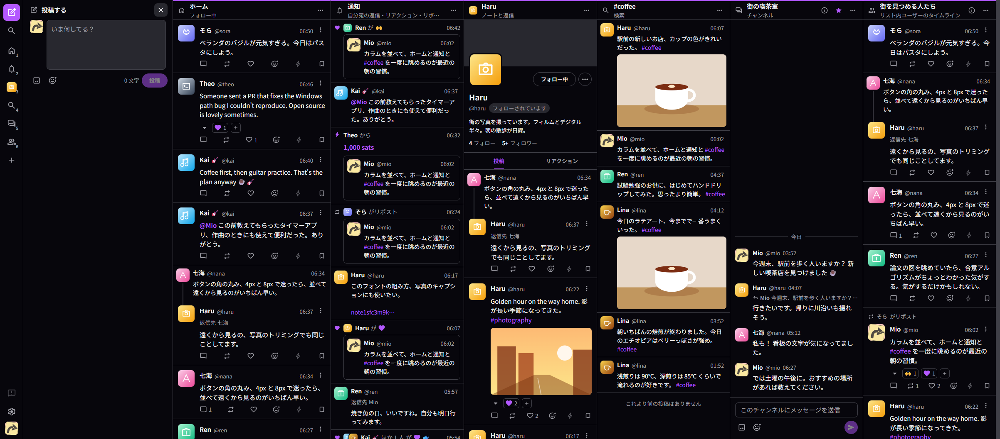
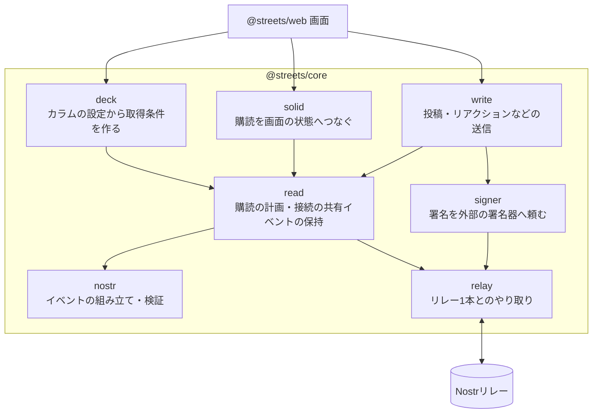
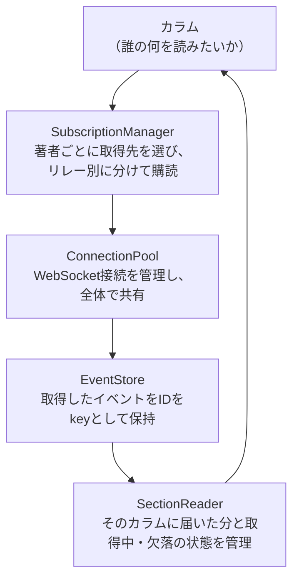
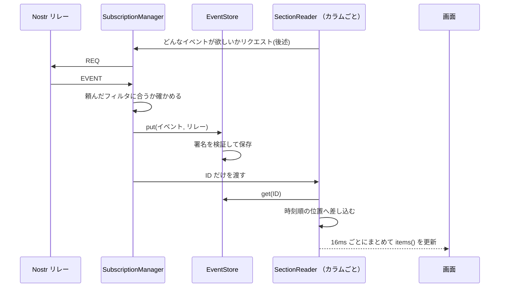
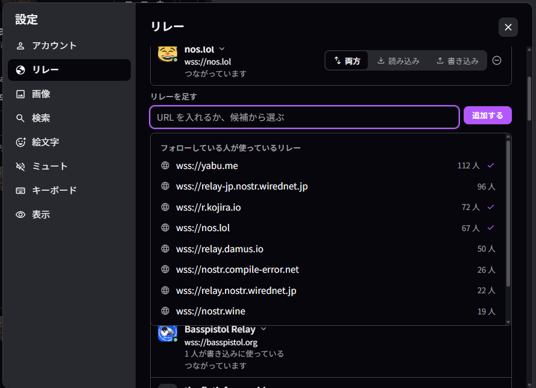
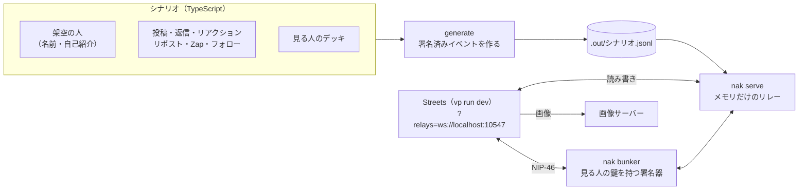

## Streetsとは

Streetsとは、私が開発している [Nostr](https://welcome.nostr-jp.org)のブラウザ向けマルチカラムクライアント です。

<https://streets.eyemono.moe>



2024年の11月にNostrを知ってすぐ開発したクライアントですが、その後数か月で燃え尽きてしまい、約1年以上開発が停止していました。

で、「改めて開発再開するか～」と今年の5月に意気込んで、開発日報を書き始めることにしました。

<https://log.eyemono.moe/posts/streets-development-diary-day-0-insights>

しかし、Day2のブログが投稿されることはなく、気づけば4か月経っちゃってました。また燃え尽きとるやんけ。

なんだかんだあって最近また開発を再開し、9/23にv1.0.0として正式版リリースを完了しました。

<https://github.com/eyemono-moe/streets/releases/tag/v1.0.0>

## 開発停滞

開発が停滞していた理由はいろいろあるんですが、主なものとしては 旧実装が残った状態で[obra/superpowers](https://github.com/obra/superpowers)を使った開発プロセスを導入してしまったことが挙げられます。

obra/superpowersは、TDD、設計、ドキュメンテーションを丁寧に進めるためのskillsをまとめたpluginで、別のプロジェクトでの開発のためにユーザースコープで導入していました。
しかし、Streetsは新規プロジェクトでなく、旧実装からの改修段階でした。旧実装が残った状態でのTDDは、LLMにとって「旧実装との互換性を考慮しつつ新しい実装を作る」というタスクになってしまい、実装が全く進まない原因になっていました。

ということでまず旧実装を全て削除しました(<https://github.com/eyemono-moe/streets/pull/341>)。
superpowersによって作成された過剰なドキュメント/コメントも一掃し(<https://github.com/eyemono-moe/streets/pull/339>)、superpowersを無効化した上で改めて開発を再開、何とかv1リリースにこぎつけました。

## Streetsの仕組み

一応技術的な話も少しだけします。

### 全体アーキテクチャ

Streetsは[`@streets/web`](https://github.com/eyemono-moe/streets/tree/main/apps/web)（画面）と[`@streets/core`](https://github.com/eyemono-moe/streets/tree/main/packages/core)（Nostrの読み書き）の2つのパッケージに分かれていて、画面はcoreだけを参照します。
coreはUIを持たず、リレーとの接続・購読・イベントの保持・書き込みをすべてここに集めています。



### タイムラインを読むとき

Nostrには「タイムラインを返すAPI」はありません。
フォローしている人ごとに投稿を置いているリレーが違うので、1つのカラムを表示するだけでも、複数のリレーへ著者を振り分けて問い合わせ、同じイベントの重複をまとめ、どのリレーが応答したか/していないかを管理する必要があります [^1]。

[^1]: Streetsは[Outbox model](https://zenn.dev/nikolat/articles/b5936ab157fcf7)を採用しています(設定で読み書きリレーを固定することもできます)

カラムを並べるクライアントでこれを愚直に実装すると、カラムの数だけWebSocketの接続管理やイベント管理が必要になり、コードが複雑になります。
なので、Streetsでは画面は「何を読みたいか」だけをcoreへ渡し、あとはcoreが引き受けます。



### イベントは1か所、カラムは参照の並び

イベントの取得リクエストからカラムに表示されるまでの流れを図にすると以下のようになります。



`EventStore`はイベントIDをキーにした`Map`で、イベント本体と「どのリレーで見たか」「いつ取ったか」を持っています。届いたリレーの記録は、あとでその投稿の取得先を探す手がかりに使います。

リレーからの`EVENT`を受けた`SubscriptionManager`は、ストアに入れたあと、そのイベントを頼んだカラムへ**IDだけ**を渡します。
カラム側の`SectionReader`は、IDでストアから本体を引き、自分の一覧に差し込みます。

これにより、Streetsでは「イベントについて知っていること」が一か所に集まるようになっています。

- 一度取ったものを取り直さない：引用された投稿を表示するとき、別のカラムがもう取っていればストアから引くだけで、リレーには問い合わせません
- 変化が全カラムに一度に届く：削除（NIP-09）が届くと、ストアが「このイベントを隠した」と知らせ、各カラムは自分の一覧から外すだけで済みます。取り消されたときも同じ位置に戻せます
- メモリも少し減る：ホームとハッシュタグのカラムに同じ投稿が出ても、持つのは同じオブジェクトへの参照2つだけです。ただ、カラムが持つのは参照の配列なので、差が出るのはカラムどうしの重なりが多いときに限られます

一方で、カラムの中身を「ストアにある全イベントをフィルタで絞ったもの」にはしていません。
いわゆる「クライアント側で疑似的にリレーを再現してクエリする」タイプの実装方針であり、これもこれで面白そうと思いつつ、Streetsでは採用していません。最初はTanstack DBを活用してこの方針で作ろうと思っていたのですが、結局「カラムごとに届いたものの並び」を持つ方が、欠落の状態/ローディング状態を正確に出せそうだったので、そちらを採用しました。

([noStrudel](https://github.com/hzrd149/nostrudel)とかは多分この方針で実装している)

### createSectionで購読を隠す

画面からは、ここまでの仕組みを`createSection`1つで使えるようにしています。

```ts
type Section = {
  items: Accessor<NostrEvent[]>; // そのカラムに届いたイベント（新しい順）
  status: Accessor<SectionStatus>; // 取得中・揃った・欠けがある、など
  paging: Accessor<Paging>; // 古い投稿を取り足せるか
  loadMore: () => void; // 古い投稿を1ページ取り足す
};

const section = createSection({
  source: () => ({ type: "nostr", filters: [{ kinds: [1], authors: followees() }] }),
  manager,
  pageSize: 50,
});
```

渡すのは「何を読みたいか」（`source`）だけで、どのリレーへ`REQ`を送るか、`EOSE`がいつ揃ったか、WebSocketが切れたらどうするかなどは画面から見えません。

- `source`は関数で、`undefined`を返している間は購読を張りません。フォロー一覧がまだ取れていない、といった状態を表すのに使います
- `source`の中身が変われば古い購読を止めて張り直し、カラムの名前や位置を変えただけの時など、中身が同じなら張り直しません
- コンポーネントが消えれば購読も止まるので、画面ごとに後始末を書く必要がありません

カラムの中身は、このセクションを1つずつ持つ部品（ブロック）の組み合わせで書いています。
例えばユーザーのカラムは、プロフィールの見出しと、「投稿」「リアクション」のタブで、タブの中身はどちらも同じ`EventList`というブロックです。

```tsx
<ProfileHeader pubkey={pubkey} />
<ColumnTabs
  tabs={[
    { label: "投稿", content: () => <EventList source={() => userPostsSource(pubkey)} /> },
    { label: "リアクション", content: () => <EventList source={() => userReactionsSource(pubkey)} /> },
  ]}
/>
```

1つのカラムにセクションがいくつあっても、接続とストアは全体で共有されるので、ブロックを増やしても表側の分岐や接続の管理は増えません。

## こだわったところ

設計部分以外のこだわりポイント

### カラムスタック

Streetsでは、タイムラインでイベントをタップしたときや、ユーザーのプロフィールを開いたときに、「カラムが上に重なる」ような構造にしています。

<video controls src="../../../public/media/streets-development-diary-day-136/1790546823150-画面録画 2026-09-28 070555.mp4" title="Title"></video>

この重ねる動作自体はv0時代から存在しており、似た挙動のマルチカラムUIを提供しているアプリも多々あるかと思いますが(<https://skeetdeck.pages.dev>など)、Streets v1ではDrawerとして表示するようにしました。
これにより、スワイプ操作でカラムを閉じられて便利。

常に表示するカラムは厳選したものだけにして、それ以外は一瞬で開く/すぐ閉じるを直感的に操作できるようにしたくてこのようにしてみました。

### リレー設定

Nostrに初めて触れる人が(ログイン方法の壁を乗り越えて次に)ぶつかる壁は、リレーの設定かと思います。

Streetsでは、なるべくリレー設定が簡単になるように心がけています。

例えば、ユーザーが利用しているリレーを簡単に一覧できるようにし、直接「自分も使う」導線を用意しています。

<video controls src="../../../public/media/streets-development-diary-day-136/1790547153992-画面録画 2026-09-28 071144.mp4" title="Title"></video>

リレー設定画面においても、フォローユーザーが利用しているリレーをサジェストするようにしています。



この辺りはどれだけ丁寧にしても足りないと思っているので、今後も改善していきたいところです(それ以前にStreets自体のカラムなどの操作説明が少ないのも改善したい)。

### スクリーンショット撮影環境

上記のカラムスタックのスクリーンショットでは、実際の本番リレーではなく、ローカルで立てた動作確認用のリレーに接続してスクリーンショットを撮影しています。以前は、実リレーに接続したうえで、テキストにぼかしを入れたりして広報に利用していましたが、新機能追加のたびにそんなことをしていては大変なため、仕組化してみました。

仕組みはこうなっています。



1. **シナリオを TypeScript で書く**：架空の人・投稿・返信・リアクション・Zap・フォロー、見る人（ログインする人）のデッキを、fixtureとして書いておきます。投稿の時刻は「基準時刻の40分前」のように相対で書きます (例：<https://github.com/eyemono-moe/streets/blob/main/tools/screenshot/src/scenarios/many-columns.ts>)
2. **署名済みのイベントを作る**：fixtureから、本物と同じ形の署名済みNostrイベントを組み立てて、JSONLに書き出します
3. **ローカルにリレーと署名器を立てる**：[nak](https://github.com/fiatjaf/nak)の`nak serve`でメモリだけで動くリレーを立ててJSONLを読み込ませ、`nak bunker`で見る人の鍵を持ったリモート署名器（NIP-46）を立てます。画像も手元のHTTPサーバーから配ります
4. **Streetsをそのリレーへ向ける**：開発サーバーを`?relays=ws://localhost:10547&screenshot`付きで開き、表示された`bunker://…`を貼ってログインします

実行すると以下のような案内が表示されるので、これに従ってログインするだけで、シナリオの通りのカラムが並んだ状態でStreetsを開くことができます。

```txt
シナリオ「all-in」: 全シナリオの投稿・通知・画像・チャンネル・リストをまとめて使う
基準時刻 2026-09-27T21:59:27.000Z で 124 件のイベントを /home/eyemono/repos/github.com/eyemono-moe/streets/tools/screenshot/.out/all-in.jsonl に書き出しました。
> relay running at ws://localhost:10547

リレー      ws://localhost:10547（止めると空に戻ります）
画像        http://localhost:10548
見る人      mio（npub18j064ht6tpkgjg5stppg0l2428rg7cth6uw6fpm4zerh3y079uvqx0drud）

1. 別の端末で  vp run dev
2. 開く        http://localhost:5173/?relays=ws://localhost:10547&screenshot
3. ログイン    「リモート署名器でログイン」に次を貼る
               bunker://...
```

開発環境ではDockerで立てたローカルリレーも活用しているのですが、スクショ環境では、nakのメモリリレーを使うことで、スクショ撮影のたびにリレーを空に戻せるようになっています。これにより、スクショ撮影のたびに「前回の投稿が残っている」などの問題が起きず、安定して同じ状態で撮影できます。

シナリオはホーム・通知・スレッド・プロフィール・複数カラム・画像・チャンネルとリストなど、撮りたい画面ごとに分けています (<https://github.com/eyemono-moe/streets/tree/main/tools/screenshot/src/scenarios>)。
全部入りの`all-in`もあり、上の動画はこれで撮りました。

## まとめ

ということで、2024年11月に開発を始め、約1年10か月、ついにv1としてリリースすることができました。

今後も、Streetsをより便利にするための開発を続けていきたいと思います。
直近ではNIPsの更新を自動で検知してStreetsに反映する仕組みを作ることを目標にしています：<https://github.com/eyemono-moe/streets/pull/682> (燃え尽きないようにするため)
